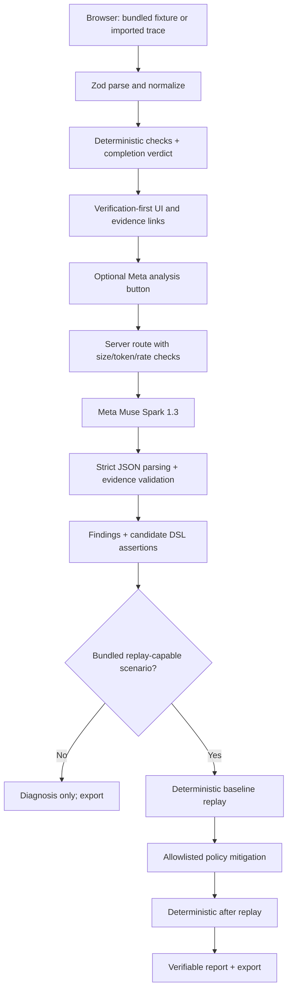
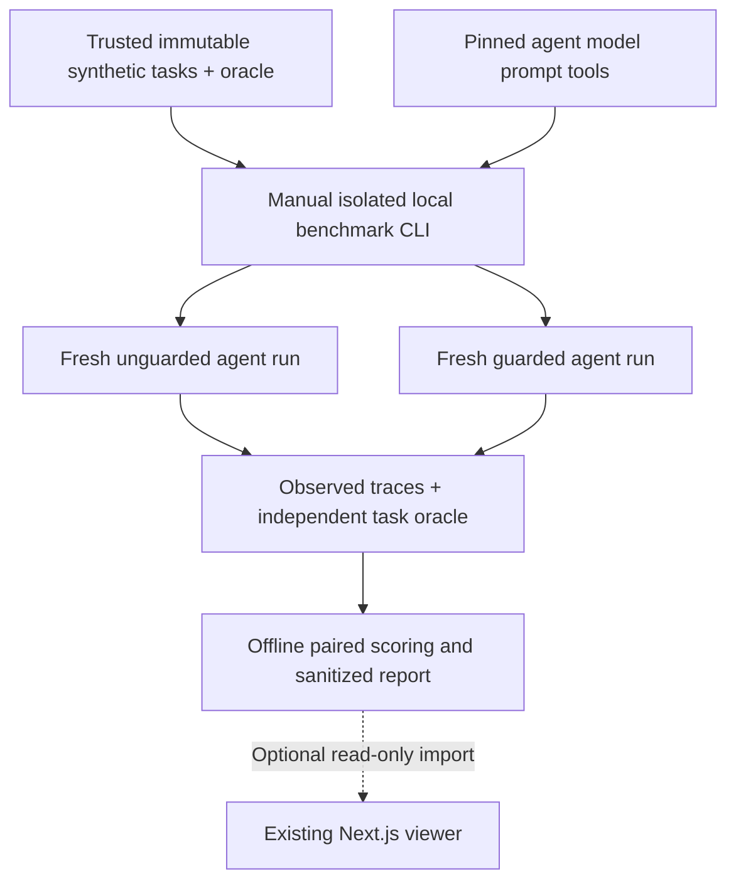
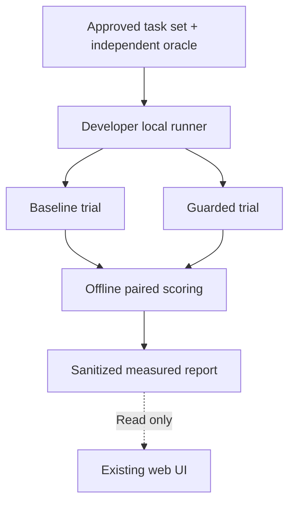

# 02 — System architecture

## Decision
**Verification-first product contract:** the deterministic verification engine emits a scoped completion verdict from typed evidence before Muse runs. In the browser, the first screen is a verdict card and evidence; model diagnosis and scripted guard controls are subsequent actions. [28](28-verify-product-north-star.md) defines wording and outcome boundaries.

A **single Next.js App Router / React / strict TypeScript application**, deployed as one Vercel project. Node.js server route handlers proxy Meta Model API; browser owns ephemeral trace/session state; deterministic replay and assertions run as pure TypeScript. No DB, queue, container execution or external user accounts.

Why: this minimizes coordination, setup, environment secrets and deployment risk in a 10-day project. Add storage only if a measured requirement makes stateless reports untenable (unlikely during the hackathon).

## Logical module boundaries
| Module | Responsibility | Input -> output | Side effects |
|---|---|---|---|
| `schemas` | Zod parse and type definition | JSON -> typed v1 records/errors | None |
| `trace` | Canonicalization, evidence indexing, ordering, redaction warnings | trace -> normalized event index | None |
| `checks` | Deterministic signal extraction | trace -> observed signal objects | None |
| `verification` | Determine scoped completion claim status with transparent reason codes and event IDs | trace + signals -> completion verdict | None |
| `meta` | Request creation, provider transport, structured parsing | trace summary -> candidate diagnosis/test/fix | HTTPS server only |
| `validation` | Resolve IDs, validate assertion DSL, reject fabricated evidence | model JSON -> trusted candidates | None |
| `scenarios` | Bundled source trace and scenario manifest | ID -> immutable fixture | None |
| `replay` | Constrained scripted state transitions, allowlisted policies | scenario + policy -> event log/verdict | None |
| `report` | Provenance, before/after diff, export | trace+findings+replay -> report | browser export |
| `ui` | Import, timeline, diagnosis, replay, transparency labels | state -> visuals | user actions |

## Data flow



## Proposed implementation tree (not files to build in this planning repo)
```text
agentharness-app/
  src/
    app/{page.tsx,api/analyze/route.ts,api/replay/route.ts,api/verify/route.ts,api/health/route.ts}
    components/{TraceTimeline,FindingCard,ReplayComparison,ImportPanel,EvidenceDrawer,ReportExport}.tsx
    lib/{schemas,trace,checks,validation,assertions,replay,report,fixtures}.ts
    server/{meta-client,rate-limit,request-guards}.ts
  fixtures/{false-success,unsupported-claim,unsafe-attempt}.json
  tests/{unit,integration,e2e}/
  docs/DEMO.md
  .env.example
```

## Runtime request paths
- Completion verdict is a pure, local TypeScript computation on normalized evidence, **not** an LLM inference or a newly required public API. It must distinguish missing evidence from contradicted evidence and never claim source bug correctness.
- Browser initial load reads public bundled synthetic fixtures only.
- `POST /api/analyze`: validates trace, truncates/summarizes to explicit budget, calls Meta, validates structured response, returns it without persistence.
- `POST /api/replay`: runs deterministic in-memory reference scenario/policy; no shell/network.
- `POST /api/verify`: replay baseline + selected allowlisted fix; compares reports server-side; no external actions.
- `GET /api/health`: configuration status only, no secret/materialized key leak.

## Determinism and boundaries
A trace is **observed historic events**, not an executable program. Imported arbitrary traces can be diagnosed and deterministically checked where rules apply; they cannot be replayed without an integrated agent runtime. Bundled replay scenarios use an internal scripted reference agent and policy state machine. Model-generated assertions are parsed and interpreted as data, not executed source.

## State and persistence
Client store retains current `trace`, `analysis`, selected fixture, replay result and report. Default memory only; refresh resets. Optional browser localStorage is deferred because imported traces may contain sensitive text. Export is explicit JSON download and includes a warning to sanitize before sharing. No raw trace content in provider logs beyond the necessary request to Meta.

## Failures and recovery
- Missing Meta key: non-live deterministic demo still works with 'offline mode' clearly labeled.
- Provider timeout/rate limit: show explicit retry affordance; keep original trace and deterministic checks.
- Malformed model JSON or invalid event refs: mark analysis invalid; do not render unverifiable evidence as verified.
- Unsupported replay: display 'analysis only' with explanation, not disabled actions pretending to work.
- Browser refresh: reload synthetic fixture, nothing silently persisted.

## Performance
UI and deterministic checks occur without network; clamp events (<=150), payload (<=256 KiB), evidence excerpts (<=400 chars each), findings (<=8), candidate assertions (<=6). Model input summarize bounded evidence but retain matching IDs. Cap replay steps at 20 per bundled scenario. Deployment runs on Node runtime, never Edge for model endpoint without testing.

## ADR-011 optional P1 architecture: real-agent experiment
The **single deployed Next.js app, API and scripted replay trust boundaries are unchanged**. A separately invoked developer-local TypeScript experiment CLI may, only after P0 security and end-to-end gates pass, run a fixed agent on **pre-vetted synthetic microtasks** in disposable isolated workspaces. It is not a production component, SaaS agent runtime, external trace replay, remote service or public route.



**Module boundary:** CLI and scoring reside in `benchmark/real-agent/` in eventual app repository, isolated from `src/app/api` and not packaged as a web runtime. It consumes a pinned task/agent/guard manifest, outputs `experiment-result.v1` local artifacts and can export a sanitized, read-only report. This is a **different provenance type** from both Meta live analysis and scripted fixture replay. Imported traces never become runnable because they came from an observed run.

**Execution gate:** require verified non-root, sealed disposable task filesystem, no host credentials, network off by default, fixed allowlisted task actions/test commands, no arbitrary model shell, time/CPU/memory/token/spend caps and kill switch. Without verified containment, do not execute T15. Pair matching task inputs, model, prompt, tools, initial workspace and independent oracle; change only guard policy, log order/seed and overhead. See [27](27-real-agent-experiment.md).


## Optional P1 — measured real-agent behavior
The deployed Next.js application and its limited scripted replay remain unchanged. If the P0 demo is working, a **developer-invoked, local, isolated benchmark CLI** can compare a fixed coding agent on trusted synthetic tasks with a completion guard off versus on. This experimental utility is not a hosted service or public feature. See [27 real-agent experiment](27-real-agent-experiment.md).



Both arms use the same pinned agent, task, initial workspace and outcome oracle; only the policy condition changes. The CLI is outside the web deployment, runs only in preverified isolated disposable environments with constrained resources, and has no ability to execute imported trace data. Without verified isolation or remaining credits, **skip P1**. The runtime contract and scope are fully specified in [27](27-real-agent-experiment.md).

## Completion-verification semantics (P0)
- Scoped `VERIFIED`: direct, sufficient observed evidence proves the **specific completion condition** (e.g. final test run success and no contradictory required events), never a general assurance of software correctness.
- `UNVERIFIED`: observed condition contradicts claimed success or required test explicitly fails.
- `INSUFFICIENT_EVIDENCE`: no usable test result, ambiguous statuses, unsupported assertions or missing required events; neither pass nor failure can be established.
- Every verdict includes machine-readable reason codes, claim scope and IDs. Muse can enrich explanation but cannot override deterministic result. Use [03 contracts](03-data-contracts.md) for the shared Zod shape. No public agent execution or arbitrary replay is added.
