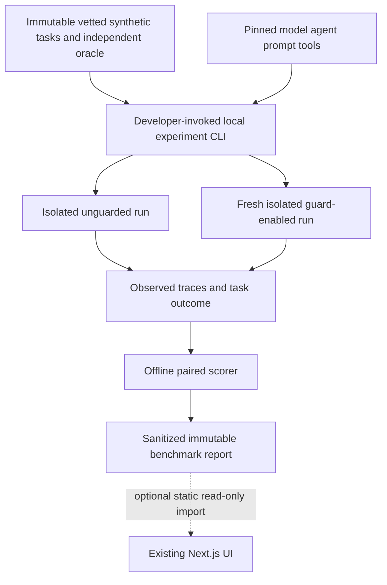

# 27 — Controlled real-agent experiment (optional P1 architecture)

**Status:** planned, not implemented or measured. **Gate:** only after P0 has a working, tested, deployed demo and the organizer rules/credits/safety controls are verified. Stop at Nov 2 feature freeze; skip if it jeopardizes submission.

## Aim
Show whether an enforceable completion guard reduces *actual false success claims* by a fixed coding agent on the same controlled tasks, not just whether our scripted fixture changes status. This **does not** demonstrate better code repair automatically, nor superiority to AgentRx or HALO.

## Boundary diagram

The **hosted Next.js app remains unchanged**: no execution API, no upload-to-execution path, no job runner, no remote repository access. Arbitrary trace imports remain analysis-only; only bundled scripted fixtures are replayable there. The experiment CLI is a developer tool, not a deployed service.

## Experimental arms
- A: identical pinned coding agent, **guard off**.
- B: same model, prompts, tools, task input, starting workspace and oracle, **guard on** (`require_passing_tests`; other policies only if task explicitly applicable).
- Optional C: prompt-only reminder without enforcement, if budget/time allow.
- Target 20–30 small synthetic tasks (honestly report smaller pilot N). Include broken tests, valid passes, unsupported claims, missing files and ambiguous cases; independently author gold before running.
- Reset workspace for every arm, freeze task/agent/model versions, alternate/randomize pair order with seed, preserve failed/timeout/abstained runs. If guard grants extra steps or testing, record overhead and note that only guard policy differs structurally.

## Outcomes and scoring
**Primary:** unjustified explicit completion claims / all eligible runs with conclusive independent oracle; report counts per arm, paired differences, uncertainty and total attempted runs.

**Mandatory checks:** legitimate successful runs wrongly blocked (false-block rate), actual task solved rate, guard trigger rate, refusal/abstention rate, UNKNOWN oracles, latency, tokens, failures, estimated/actual verified cost. A guard that refuses everything is not successful. Never equate a simulated policy PASS with source-code correctness.

## Runner security preconditions — mandatory
- Only hand-reviewed, pinned **synthetic** task workspaces, static allowlisted tools/test commands and bounded file edits inside isolated disposable working directory.
- Confirm non-root, no host secret mounts/home directories, no privileged tools or Docker socket, network egress off by default (any model connection mediated by explicitly scoped credential/proxy), process/CPU/memory/time/token/cost caps, cleanup and kill switch.
- **Never** execute imported traces, user-submitted commands, model-authored arbitrary shell scripts, external repos, or arbitrary model-proposed tests. If verified isolation isn't possible, **do not run** this experiment.
- Hosted web API never launches or controls the runner. Optional benchmark report is sanitized and read-only.

## Local artifact contracts (NOT public API schemas)
`experiment-plan.v1`: experimentId, taskManifestRevision/hashes, goldOracleRevision, pinned agent/model/prompt/tool versions, guardVersion, seed/order, isolationReview, maxRuns/maxTokens/maxSpend, status.

`experiment-result.v1`: experimentId, taskId/hash, arm, runId, initial/final workspace hashes, observed trace digest, provenance=`observed_real_agent_run`, completionClaim, independent oracle status PASS/FAIL/UNKNOWN, guardOutcome, tool errors, run order, latency, tokens, spend with pricing provenance, failure/timeout. Not interchangeable with `replay-result.v1`.

## Required procedure
1. Freeze tasks and gold labels before observing responses, commit hashes.
2. Validate isolation and budget gates; run a single baseline/guard pair first.
3. Collect all paired runs with identical agent configuration, fresh environments and logged ordering.
4. Score independently; retain errors and excluded runs in denominators, never silently drop outliers.
5. Report per-task table, counts, blocked legitimate successes, actual task success, latency and cost.
6. Optional static read-only report in app only if completed safely before feature freeze; otherwise mark NOT RUN and ship P0.

**Judge-safe conclusion template:** "In N paired, controlled runs, unjustified success claims changed from X/N to Y/N, with Z legitimate successes blocked and actual task resolution W. These results apply to this pinned agent and task distribution only." Fill only with measured numbers.
